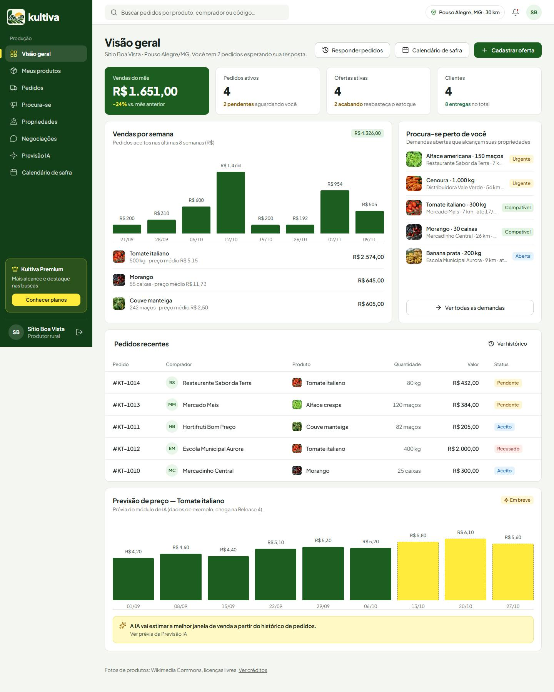
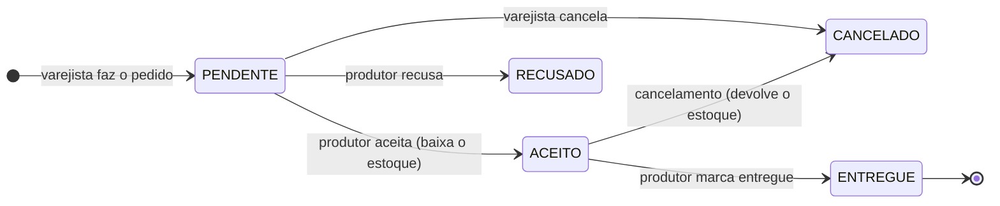
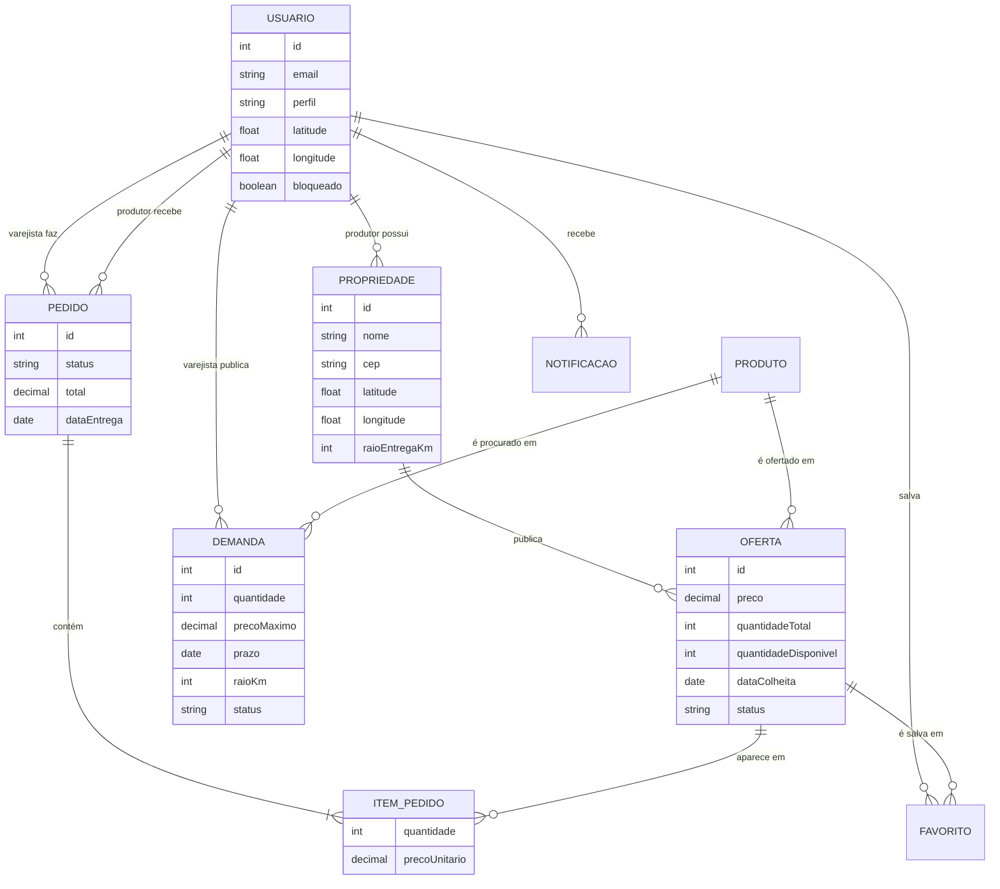
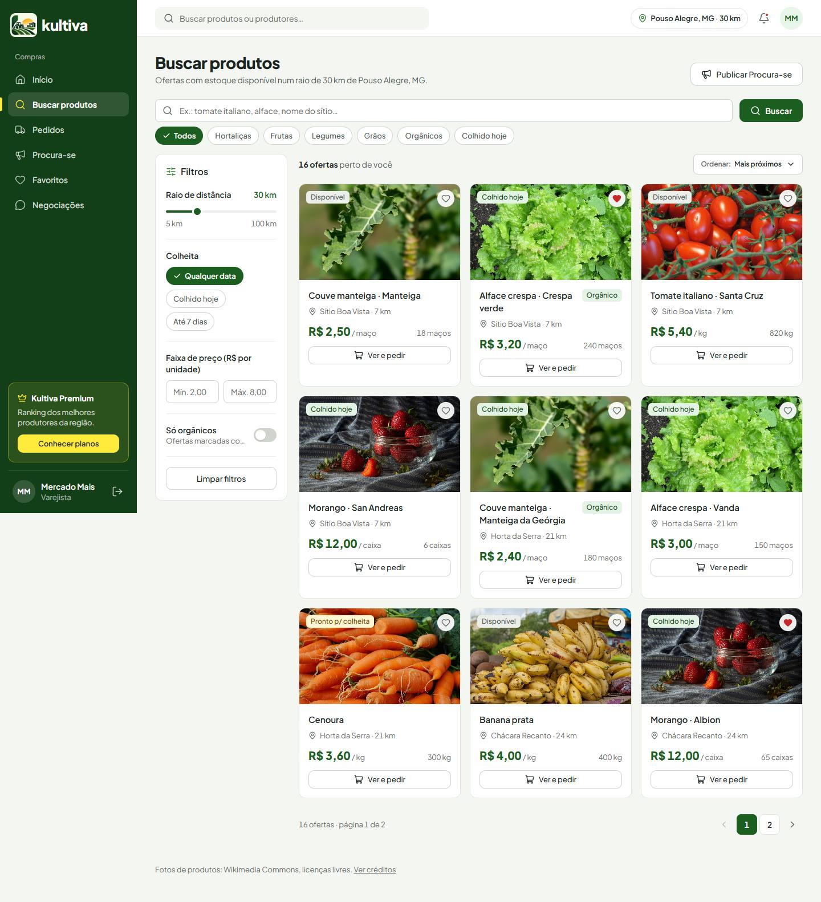
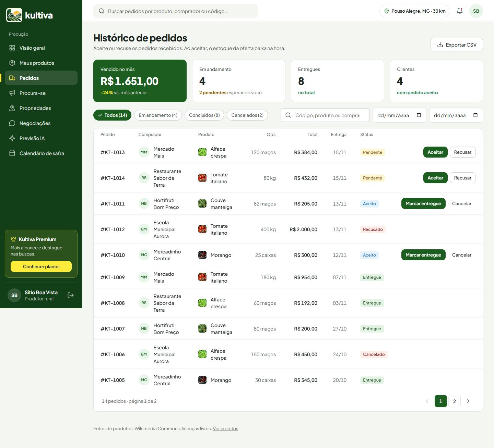
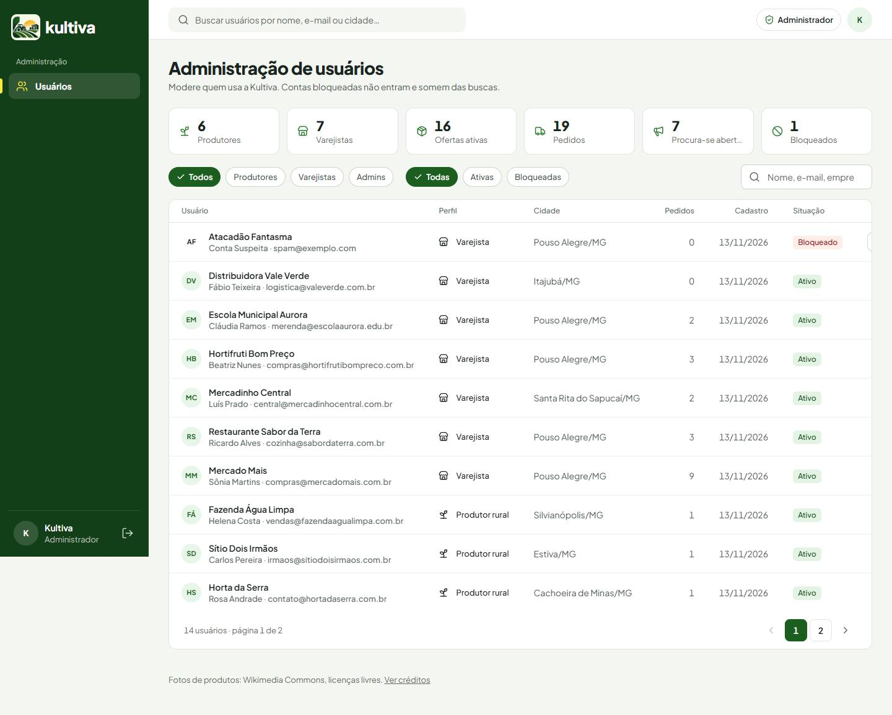
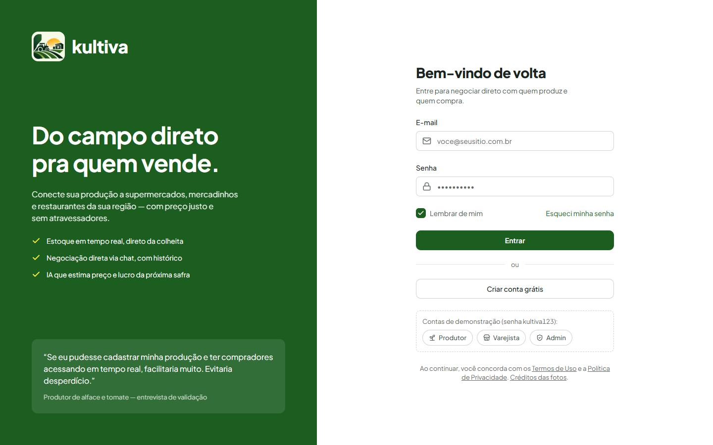
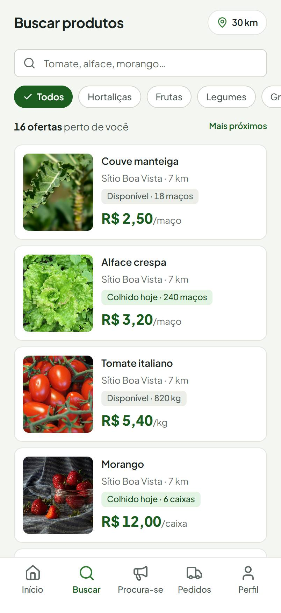
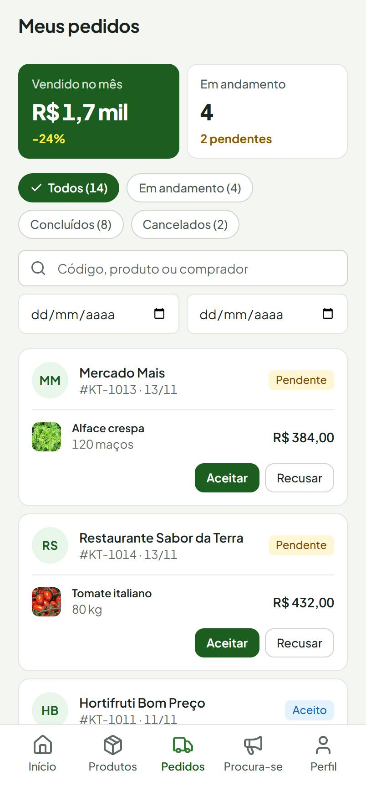

<div align="center">


# Kultiva

**Do campo direto para quem vende.**

Plataforma web B2B que conecta pequenos e médios produtores rurais ao varejo da região:<br/>
o produtor publica o que colheu, o mercado encontra perto de casa e o pedido baixa o estoque sozinho.


Agro + Sustentabilidade · UNIVÁS

</div>

<p align="center">
  
</p>

---

## Sumário

- [O problema](#o-problema)
- [Release 3: o que foi entregue](#release-3-o-que-foi-entregue)
- [Como rodar](#como-rodar)
- [Roteiro da demonstração](#roteiro-da-demonstração)
- [Regra de negócio](#regra-de-negócio)
- [Modelo de dados](#modelo-de-dados)
- [API](#api)
- [Segurança](#segurança)
- [Telas](#telas)
- [Estrutura do projeto](#estrutura-do-projeto)
- [Testes e CI](#testes-e-ci)
- [Equipe](#equipe)
- [Próximos passos](#próximos-passos-release-4)

## O problema

A venda de hortifruti entre produtor e varejo ainda é feita por telefone e WhatsApp, item a item, sem histórico. O produtor depende de atravessadores e não sabe quem vai comprar a colheita; o mercado não sabe quem produz perto dele nem quanto há disponível.

A Kultiva resolve isso com:

- **Busca por região:** a distância entre o varejista e cada propriedade é calculada e entra no filtro e na ordenação.
- **Estoque em tempo real:** cada pedido aceito baixa a quantidade disponível, e o sistema não aceita pedido acima do estoque.
- **Procura-se:** o varejista publica o que precisa e os produtores compatíveis são avisados na hora.
- **Histórico de pedidos:** compras e vendas registradas, com filtro, busca e exportação em CSV.

## Release 3: o que foi entregue

| Requisito da release | Situação | Onde está |
| --- | :---: | --- |
| CRUDs obrigatórios e relacionamentos | ✅ | **Propriedade**, **Oferta** e **Procura-se (Demanda)** completos pela interface; Pedido, Notificação e Favorito também. 1:N e N:N no [modelo de dados](#modelo-de-dados) |
| Perfis de acesso e rotas protegidas no back-end | ✅ | JWT + middleware `permitir('PRODUTOR')` em cada rota ([server/src/middleware/auth.js](server/src/middleware/auth.js)); o front também bloqueia rotas por perfil |
| Regra de negócio principal | ✅ | Fluxo de status do pedido com baixa atômica de estoque ([server/src/services/pedidos.js](server/src/services/pedidos.js)) + match do Procura-se ([server/src/services/match.js](server/src/services/match.js)) |
| Busca/filtro e paginação | ✅ | Ofertas (texto, categoria, preço, distância, colheita, orgânico, ordenação), pedidos (status, texto, período), demandas, notificações e usuários, todos paginados |
| As 8 telas mínimas | ✅ | 16 telas já funcionam com dados reais da API ([lista](#telas)) |
| Metade dos pontos de complexidade | ✅ | 6 de 12 pontos ([tabela](#pontos-de-complexidade)) |
| Demonstração ao vivo + tag `v0.3` | ✅ | [Roteiro da demonstração](#roteiro-da-demonstração) |

### Pontos de complexidade

| Funcionalidade | Pontos | Situação | Onde aparece |
| --- | :---: | :---: | --- |
| Layout responsivo | 1 | ✅ | Abaixo de 768px a sidebar vira navegação inferior e as tabelas viram cards |
| Documentação da API (Swagger) | 1 | ✅ | `http://localhost:3333/docs` |
| Dashboard com gráficos | 2 | ✅ | Vendas por semana, mais vendidos, KPIs do mês ([Dashboard.jsx](src/pages/produtor/Dashboard.jsx)) |
| Integração com API externa | 2 | ✅ | ViaCEP preenche o endereço no cadastro e nas propriedades; coordenadas + distância (Haversine) priorizam a região |
| CI/CD com deploy automático | 3 | 🟡 | CI pronto (lint, build e testes com PostgreSQL); o deploy automático entra na R4 |
| Tempo real com WebSocket | 3 | ⏳ | Release 4 (chat e avisos ao vivo) |
| **Concluído** | **6 / 12** | | |

## Como rodar

**Pré-requisito:** Node.js 22 ou mais novo. Não precisa instalar PostgreSQL: o projeto sobe um Postgres local via npm (`embedded-postgres`). Se preferir, use um Postgres seu ou do Neon trocando o `DATABASE_URL`.

```bash
# 1. dependências (front e API)
npm install
npm run api:install

# 2. variáveis da API
cp server/.env.example server/.env      # troque o JWT_SECRET

# 3. banco local — deixe este terminal aberto
npm run api:db

# 4. em outro terminal: cria as tabelas e os dados de demonstração
npm run api:setup

# 5. sobe a API (porta 3333) e, em outro terminal, o front (porta 5173)
npm run api
npm run dev
```

Abra **http://localhost:5173**. A documentação da API fica em **http://localhost:3333/docs**.

> Para recomeçar a demonstração do zero, rode `npm --prefix server run db:seed`: ele apaga os dados de exemplo e cria tudo de novo.

### Contas de demonstração

Todas com a senha **`kultiva123`**. Na tela de login há atalhos para preencher cada uma.

| Perfil | E-mail | O que ver |
| --- | --- | --- |
| Produtor | `joao@sitioboavista.com.br` | Sítio Boa Vista: 2 propriedades, 7 ofertas, 2 pedidos esperando resposta |
| Varejista | `compras@mercadomais.com.br` | Mercado Mais: busca, favoritos, demandas Procura-se e pedidos |
| Administrador | `admin@kultiva.com.br` | Moderação de usuários (há uma conta bloqueada de exemplo) |

## Roteiro da demonstração

Leva uns 8 minutos e passa por todos os itens da Release 3.

1. **Rotas protegidas.** Abra `/produtor` sem login e veja o redirecionamento para `/login`. Em `/docs`, chame `GET /api/ofertas` sem token e veja o `401`.
2. **Varejista busca.** Entre como *Mercado Mais* e abra **Buscar produtos**. Mude o raio de 30 para 10 km, filtre por "Legumes" e preço máximo de 5,50, ordene por menor preço e passe para a página 2.
3. **Faz o pedido.** Abra *Alface crespa · Sítio Boa Vista*, escolha 100 maços, inclua tomate do mesmo produtor e clique em **Fazer pedido**. O pedido fica **pendente**.
4. **Bloqueio de estoque.** Na mesma tela, o seletor não passa do disponível. Pelo Swagger, um `POST /api/pedidos` acima do estoque devolve `409 Estoque insuficiente`.
5. **Produtor aceita.** Saia e entre como *João*. O sino mostra o novo pedido. Em **Pedidos**, clique em **Aceitar**: o estoque cai na hora em **Meus produtos**.
6. **Concorrência.** Se dois pedidos somam mais que o estoque, o segundo aceite é recusado com `409` e nada é baixado.
7. **CRUDs do produtor.** Em **Propriedades**, cadastre uma propriedade nova digitando só o CEP (ViaCEP preenche a cidade). Em **Meus produtos**, crie, edite, pause e exclua uma oferta.
8. **Procura-se.** Como varejista, publique "200 kg de Banana prata até R$ 4,50". A tela mostra quantos produtores compatíveis existem antes de publicar, e eles recebem a notificação.
9. **Administrador.** Entre como admin, bloqueie um varejista e tente logar com ele: acesso negado.

## Regra de negócio

O ciclo de vida do pedido controla o estoque.



- **Ao criar** ([criarPedido](server/src/services/pedidos.js)): o sistema recusa quantidade acima do disponível ou abaixo do pedido mínimo, oferta pausada ou esgotada, e itens de produtores diferentes no mesmo pedido.
- **Ao aceitar** ([mudarStatus](server/src/services/pedidos.js)): numa transação, cada item faz um `UPDATE ... WHERE quantidadeDisponivel >= quantidade`. Se outro pedido levou o estoque antes, nada é baixado e a API responde `409`. Oferta que chega a zero vira **ESGOTADA**.
- **Ao cancelar um pedido aceito:** o estoque volta e a oferta é reativada.
- **Cada transição notifica a outra parte**, e cada perfil só vê as ações que pode executar (o campo `acoes` do pedido).

**Match do Procura-se** ([match.js](server/src/services/match.js)): quando o varejista publica uma demanda, o sistema procura ofertas ativas do mesmo produto, com estoque, preço até o máximo informado e propriedade dentro do raio. Cada produtor compatível recebe uma notificação. O caminho inverso também vale: quando uma oferta é publicada, os varejistas com demanda compatível são avisados.

## Modelo de dados



- **1:N:** Produtor → Propriedades → Ofertas; Varejista → Pedidos; Varejista → Demandas.
- **N:N:** Pedido ↔ Oferta pela tabela **ItemPedido** (quantidade e preço negociado). Varejista ↔ Oferta pela tabela **Favorito**.
- Schema completo em [server/prisma/schema.prisma](server/prisma/schema.prisma).

## API

REST em `/api`, documentada com Swagger em **`/docs`** (com botão *Authorize* para testar com o token). Principais rotas:

| Recurso | Rotas | Perfil |
| --- | --- | --- |
| Autenticação | `POST /auth/cadastro` · `POST /auth/login` · `POST /auth/logout` · `GET/PUT/DELETE /auth/me` | público / logado |
| CEP | `GET /cep/:cep` (ViaCEP + coordenadas) | público |
| Propriedades | `GET POST /propriedades` · `GET PUT DELETE /propriedades/:id` | Produtor |
| Ofertas | `GET /ofertas` (busca paginada) · `GET /ofertas/minhas` · `POST` · `PUT/DELETE /:id` · `PATCH /:id/status` | Produtor (CRUD) · todos (busca) |
| Pedidos | `GET /pedidos` (histórico paginado) · `POST /pedidos` · `PATCH /pedidos/:id/status` | Varejista cria · Produtor aceita, recusa, entrega |
| Procura-se | `GET POST /demandas` · `GET /demandas/previa` · `PUT/DELETE /:id` · `PATCH /:id/status` | Varejista (CRUD) · Produtor (vê as da região) |
| Notificações | `GET /notificacoes` · `GET /nao-lidas` · `PATCH /lidas` · `PATCH /:id/lida` · `DELETE /:id` | logado |
| Favoritos | `GET /favoritos` · `POST/DELETE /favoritos/:ofertaId` | Varejista |
| Dashboard | `GET /dashboard` | Produtor, Varejista |
| Administração | `GET /admin/resumo` · `GET /admin/usuarios` · `PATCH /admin/usuarios/:id/bloqueio` | Admin |

Listas paginadas sempre respondem `{ data, page, pageSize, total, totalPages }`. Erros respondem `{ error, details: [{ campo, mensagem }] }`, e o front mostra cada mensagem embaixo do campo certo.

## Segurança

- **Senhas** com hash `bcrypt`. O login devolve a mesma mensagem para e-mail inexistente ou senha errada.
- **JWT** com expiração (`JWT_EXPIRES_IN`). A cada requisição, a API confere se o usuário ainda existe e não está bloqueado.
- **Três perfis** checados no back-end com `permitir(...)`, além da conferência de dono: ninguém edita a oferta, a propriedade ou a demanda de outra pessoa.
- **Validação com Zod** em todo corpo e query, com mensagens em português.
- **Prisma** com queries parametrizadas (proteção contra SQL Injection).
- **Helmet**, CORS restrito por `CORS_ORIGIN` e limite de tentativas no login e no cadastro (`express-rate-limit`).
- **Segredos** em `server/.env`, fora do Git (há um `.env.example` de modelo).

## Telas

| # | Tela | Perfil | Rota | Dados |
| --- | --- | --- | --- | :---: |
| 01 | Login (com atalhos das contas de demonstração) | Todos | `/login` | API |
| 02 | Cadastro em 2 passos com CEP | Todos | `/cadastro` | API |
| 03 | Visão geral: KPIs, vendas por semana, Procura-se da região | Produtor | `/produtor` | API |
| 04 | Meus produtos: estoque em tempo real, pausar, excluir | Produtor | `/produtor/produtos` | API |
| 05 | Cadastrar / editar oferta | Produtor | `/produtor/produtos/nova` · `/:id` | API |
| 06 | Propriedades (CRUD com CEP) | Produtor | `/produtor/propriedades` | API |
| 07 | Procura-se da região (compatíveis, urgentes) | Produtor | `/produtor/procura-se` | API |
| 08 | Notificações | Produtor e Varejista | `/…/notificacoes` | API |
| 09 | Início do varejista | Varejista | `/varejista` | API |
| 10 | Buscar produtos (filtros + paginação) | Varejista | `/varejista/buscar` | API |
| 11 | Detalhe da oferta e pedido com vários itens | Varejista | `/varejista/produto/:id` | API |
| 12 | Minhas demandas Procura-se | Varejista | `/varejista/procura-se` | API |
| 13 | Publicar / editar Procura-se com prévia do match | Varejista | `/varejista/procura-se/nova` · `/:id` | API |
| 14 | Histórico de pedidos com ações | Produtor e Varejista | `/…/pedidos` | API |
| 15 | Favoritos | Varejista | `/varejista/favoritos` | API |
| 16 | Perfil e configurações | Todos | `/…/perfil` | API |
| 17 | Administração de usuários | Admin | `/admin/usuarios` | API |
| — | Negociação (chat), Calendário de safra, Previsão IA, Planos | Produtor e Varejista | | exemplo (R4) |

<table>
  <tr>
    <td></td>
    <td></td>
  </tr>
  <tr>
    <td align="center"><sub>Busca com filtro por distância e paginação</sub></td>
    <td align="center"><sub>Pedidos: aceitar baixa o estoque</sub></td>
  </tr>
  <tr>
    <td></td>
    <td></td>
  </tr>
  <tr>
    <td align="center"><sub>Administração de usuários</sub></td>
    <td align="center"><sub>Login</sub></td>
  </tr>
</table>

<p align="center">
  
  &nbsp;&nbsp;
  
</p>

## Estrutura do projeto

```
kultiva/
├── src/                       # Front-end React + Vite
│   ├── api/client.js          # fetch com token JWT e erros padronizados
│   ├── auth/AuthContext.jsx   # sessão, login/logout e <RequireAuth perfis={…}>
│   ├── components/            # design system (ui, cards, Feedback, layout)
│   ├── hooks/                 # useApi, useQueryState (filtros na URL), useUnsavedChanges
│   └── pages/                 # produtor/, varejista/, admin/ e telas compartilhadas
├── server/                    # API Express + Prisma
│   ├── prisma/                # schema, migrations e seed de demonstração
│   ├── src/
│   │   ├── routes/            # uma rota por recurso
│   │   ├── services/          # regras de negócio (pedidos, match, notificações)
│   │   ├── middleware/        # autenticação, perfis, validação, erros
│   │   ├── lib/               # Prisma, CEP, geolocalização, paginação, schemas Zod
│   │   └── docs/openapi.js    # documentação Swagger
│   └── tests/                 # Vitest + Supertest
├── docs/img/                  # capturas usadas neste README
└── .github/workflows/ci.yml   # lint, build e testes a cada push
```

## Stack

| Camada | Tecnologia |
| --- | --- |
| Front-end | React 19, Vite, React Router, lucide-react |
| Back-end | Node.js, Express 5 |
| Banco e ORM | PostgreSQL + Prisma |
| Autenticação | JWT + bcrypt |
| Validação | Zod |
| Documentação | Swagger (OpenAPI 3) |
| Testes | Vitest + Supertest |
| CI | GitHub Actions |
| Deploy (R4) | Vercel (front), Render (API), Neon (banco) |

## Testes e CI

```bash
npm test          # roda os testes da API (precisa do banco rodando)
npm run lint      # oxlint no front
```

Os 23 testes cobrem:

- o fluxo de status;
- o bloqueio de pedido acima do estoque;
- a baixa e a devolução de estoque;
- a concorrência entre dois aceites;
- as permissões por perfil;
- o bloqueio pelo admin;
- a validação;
- a paginação;
- o match do Procura-se.

O workflow [ci.yml](.github/workflows/ci.yml) roda lint e build do front e os testes da API contra um PostgreSQL de verdade a cada push na `main` e em cada pull request.

## Equipe

| Integrante | Papel |
| --- | --- |
| Gabrielly | Front-end: telas em React, design system e integração com a API |
| Rian | Product Owner: backlog, priorização e validação com usuários |
| Eduardo Leite | Back-end: APIs, regras de negócio e autenticação |
| Bruno | Banco de dados e deploy: modelagem, persistência e CI/CD |

Fluxo de trabalho: uma branch por funcionalidade, pull request revisado por outro integrante e uma tag por release (`v0.2`, `v0.3`, `v1.0`).

## Próximos passos (Release 4)

- [ ] Chat de negociação em tempo real com Socket.IO (US11), com avisos ao vivo de pedido e Procura-se
- [ ] Deploy automático: Vercel + Render + Neon a partir do GitHub Actions
- [ ] Calendário de safra com dados das ofertas (US14)
- [ ] Previsão de preço com IA a partir do histórico de pedidos
- [ ] Recuperação de senha por e-mail

---

<sub>Fotos de produtos: Wikimedia Commons, licenças livres (créditos em `/creditos`).</sub>
